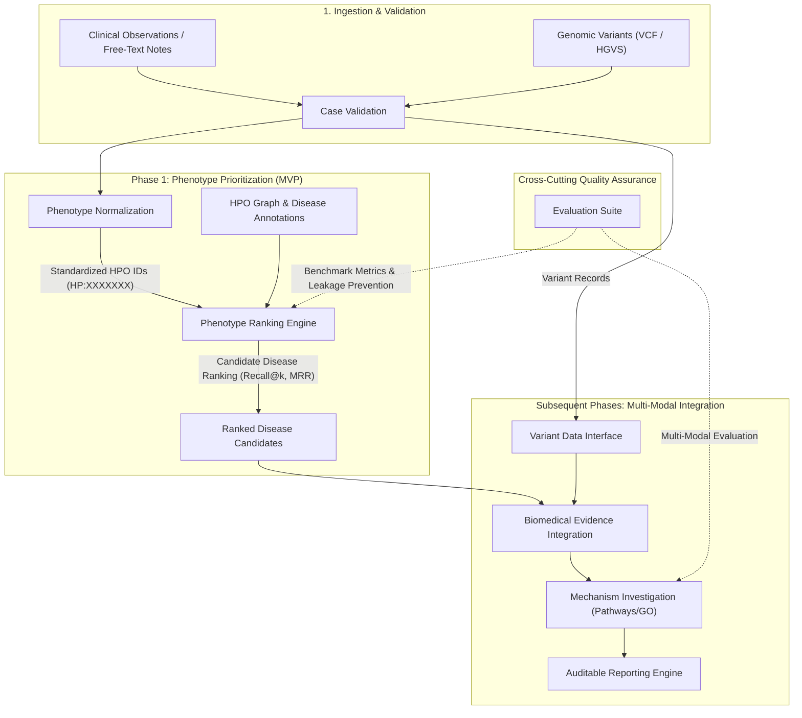

# Architecture Blueprint: Modular Pipeline Design

## 1. Architectural Philosophy

The **AI-Powered Rare Disease Diagnosis & Variant-to-Mechanism Intelligence** architecture is built upon four design tenets:

1. **Pipeline Modularity:** Each computational task is encapsulated in an independent module with defined input/output schemas and zero hidden global state.
2. **Sequential Staging:** Phenotype ranking is implemented first as the core foundational engine. Variant interpretation, knowledge graph retrieval, and pathway reasoning are layered incrementally in subsequent phases.
3. **Auditability & Provenance:** Every score, rank, and hypothesis is fully explainable and traceable back to underlying ontology nodes, literature assertions, or variant coordinates.
4. **Resilience to Incomplete Data:** Rare disease cases frequently present with partial phenotype observations or absent genetic sequencing; the pipeline gracefully operates on phenotype-only cases while accommodating multi-modal data when available.

---

## 2. End-to-End Pipeline Overview



---

## 3. Modular Pipeline Stages

### Stage 1: Case Validation (`rare_disease_ai.case_validation`)
- **Responsibility:** Ingests raw case payloads (phenotypic features, patient metadata, age of onset, and optional genomic variant specifications).
- **Validation Rules:**
  - Enforces schema integrity, type validation, and structural constraints.
  - Verifies presence of at least one clinical sign/symptom.
  - Ensures genomic variant coordinates conform to recognized formats (e.g., 1-based coordinates for HGVS, valid chromosomes 1-22, X, Y, MT).
  - Sanitizes input data to prevent injection or malformed payloads.

### Stage 2: Phenotype Normalization (`rare_disease_ai.phenotype_normalization`)
- **Responsibility:** Maps clinical findings and descriptive terms into canonical Human Phenotype Ontology identifiers (`HP:XXXXXXX`).
- **Capabilities:**
  - Exact identifier resolution and synonym dictionary lookup.
  - Graph-aware normalization (resolving obsolete or replaced term IDs via HPO `alt_id` and `replaced_by` edges).
  - Explicit tracking of term negation (e.g., "absence of seizures") and modifier terms (e.g., severity, age of onset).
- **Output Contract:** A validated list of active, standardized HPO terms annotated with metadata.

### Stage 3: Phenotype Ranking Engine (`rare_disease_ai.phenotype_ranking`)
- **Responsibility:** Computes similarity metrics between the patient's standardized phenotype profile and curated rare disease profiles.
- **Methodology (Phase 1 MVP):**
  - **Information Content (IC):** Quantifies phenotypic specificity based on disease annotation frequency across the ontology:
    $$\text{IC}(t) = -\ln(p(t))$$
  - **Semantic Similarity Metrics:** Computes pairwise concept similarity (e.g., Resnik similarity using the Most Informative Common Ancestor / MICA, Lin similarity, or Jaccard graph overlap):
    $$\text{Sim}_{\text{Resnik}}(t_1, t_2) = \text{IC}(\text{MICA}(t_1, t_2))$$
  - **Symmetric Best-Match Average (BMA):** Aggregates term-level pairwise similarities between patient phenotype set $P$ and disease phenotype set $D$:
    $$\text{Score}_{\text{BMA}}(P, D) = \frac{1}{2}\left(\frac{1}{|P|}\sum_{p \in P} \max_{d \in D} \text{Sim}(p, d) + \frac{1}{|D|}\sum_{d \in D} \max_{p \in P} \text{Sim}(p, d)\right)$$
- **Output Contract:** Ranked list of candidate diseases with composite similarity scores, p-values/significance estimates, and term-by-term attribution matrices.

### Stage 4: Variant Data Interface (`rare_disease_ai.variant_interface`)
- **Responsibility:** Ingests, normalizes, and abstracts genomic variant representations (VCF records, HGVS notation).
- **Capabilities (Future Phase):**
  - Standardizes chromosome nomenclature (e.g., `chr1` vs `1`).
  - Validates coordinate consistency against reference builds (GRCh37 / GRCh38).
  - Encapsulates variant consequences (missense, nonsense, frameshift, splice donor/acceptor) without hardcoding proprietary annotation formats.
- **Output Contract:** Normalized variant objects with coordinate, allele, and predicted molecular consequence metadata.

### Stage 5: Biomedical Evidence Integration (`rare_disease_ai.biomedical_evidence`)
- **Responsibility:** Cross-references candidate diseases and implicated genes with curated biomedical knowledge bases (e.g., ClinVar, Monarch Initiative).
- **Capabilities (Future Phase):**
  - Retrieves verified gene-disease associations and mode of inheritance (autosomal dominant, autosomal recessive, X-linked).
  - Collects curated variant pathogenicity assertions (ClinVar review status, ACMG criteria mappings).
  - Enforces strict provenance records for all external evidence.

### Stage 6: Mechanism Investigation (`rare_disease_ai.mechanism_investigation`)
- **Responsibility:** Performs functional biological enrichment to uncover the molecular etiology connecting genetic perturbations to observed phenotypes.
- **Capabilities (Future Phase):**
  - Pathway over-representation analysis (e.g., Reactome pathways, Gene Ontology Biological Processes).
  - Mechanistic hypothesis generation explaining how functional disruptions in candidate genes produce the patient's multi-system phenotypes.

### Stage 7: Auditable Reporting (`rare_disease_ai.reporting`)
- **Responsibility:** Assembles human-interpretable, machine-verifiable diagnostic intelligence reports.
- **Deliverables:**
  - Candidate disease rankings with decomposed sub-scores (phenotype semantic similarity, variant pathogenicity, literature support).
  - Visual evidence graphs illustrating ontology paths linking patient terms to disease definitions.
  - Explicit provenance metadata (database versions, release dates, algorithm parameters).

### Stage 8: Evaluation Suite (`rare_disease_ai.evaluation`)
- **Responsibility:** Continuously benchmarks ranking performance against curated, ground-truth clinical cases.
- **Capabilities:**
  - Automated calculation of ranking metrics: Recall@1, Recall@5, Recall@10, Mean Reciprocal Rank (MRR).
  - Controlled noise injection (phenotype dropping, imprecise ancestor substitution, unrelated co-morbidities) to assess robustness.
  - Temporal and ontological data leakage guards.

---

## 4. Staging Rationale: Phenotype Ranking Precedes Variant Interpretation

A foundational architectural decision of this project is to **implement and validate phenotype ranking (Phase 1) prior to introducing variant interpretation (Phase 3 & 4)**.

### Rationale
1. **Clinical Entry Point:** The rare disease diagnostic process begins with clinical observation. Patients undergo clinical evaluation long before whole-exome (WES) or whole-genome sequencing (WGS) data is ordered, sequenced, and aligned.
2. **Computational Search Space Reduction:** The Human Phenotype Ontology encompasses thousands of diseases. A robust phenotype ranking algorithm narrows the diagnostic search space from ~10,000 disorders down to a ranked shortlist of top candidates, dramatically simplifying downstream variant filtering.
3. **Isolation of Complexity:** Genomic variant interpretation involves substantial complexity:
   - Coordinate liftovers between GRCh37 and GRCh38.
   - Ambiguities in variant nomenclature (HGVS vs SPDI).
   - Conflicting clinical significance assertions in ClinVar.
   - High background rate of benign or uncertain variants of unknown significance (VUS) in normal genomes.
   Coupling variant parsing prematurely to the core ranking engine would obscure algorithmic defects in phenotype matching and create brittle, difficult-to-test code.
4. **Independent Benchmarkability:** Established phenotypic benchmark datasets (such as clinical case vignettes with known causative OMIM/Orphanet diagnoses) allow comprehensive validation of the phenotype engine in complete isolation from genomic variant noise.

---

## 5. Interface Contracts & Data Flow Boundaries

To maintain clean separation of concerns, communication across modules occurs via immutable, validated data objects:

```text
CaseInputPayload
   │
   ▼
[case_validation] ────────► ValidatedCaseRecord
                               │
                               ├──────────────────────────┐
                               ▼                          ▼
                  [phenotype_normalization]     [variant_interface]
                               │                          │
                               ▼                          ▼
                     NormalizedPhenotypeSet     NormalizedVariantSet
                               │                          │
                               ▼                          │
                      [phenotype_ranking]                 │
                               │                          │
                               ▼                          │
                     RankedDiseaseCandidateList           │
                               │                          │
                               ├──────────────────────────┘
                               ▼
                     [biomedical_evidence]
                               │
                               ▼
                     IntegratedEvidenceRecord
                               │
                               ▼
                   [mechanism_investigation]
                               │
                               ▼
                      MechanisticHypothesis
                               │
                               ▼
                          [reporting]
                               │
                               ▼
                     FinalDiagnosticReport
```

Each stage defines its input and output types explicitly using standard dataclasses or typed dictionaries, ensuring that modules can be tested with synthetic mocks without requiring live database connections or downstream components.
