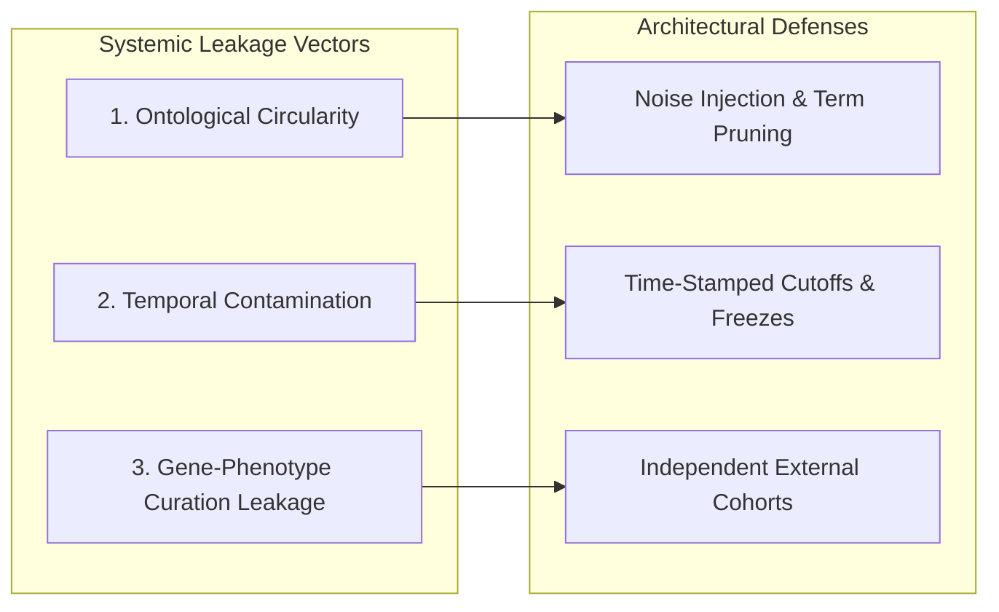

# Evaluation Plan: Baseline Metrics, Leakage Prevention, and Benchmarking Protocols

> [!IMPORTANT]
> **NO FABRICATED BENCHMARKS IN PHASE 0**
> In accordance with scientific integrity guidelines, this document defines the quantitative evaluation framework, metric definitions, and validation protocols. No empirical benchmark numbers, baseline scores, or performance tables are reported here, as implementation of the ranking engine begins in Phase 1.

---

## 1. Evaluation Philosophy

Evaluating rare disease prioritization algorithms requires protocols that mirror the clinical realities of incomplete information, phenotypic noise, and diagnostic uncertainty. Standard machine learning evaluation splits (random 80/20 train/test splits) are invalid in this domain due to systemic risk of data leakage and circular ontology definitions.

The evaluation suite within `rare_disease_ai.evaluation` is designed to provide:
1. **Clinically Meaningful Metrics:** Prioritize top-rank inclusion (Recall@1, Recall@5) and rank-order efficiency (MRR).
2. **Absolute Data Leakage Immunity:** Guard against circular definition leakage, temporal contamination, and memorization.
3. **Reproducible Provenance:** Track exact ontology versions, scoring algorithms, and case configurations.
4. **Noise-Perturbed Robustness Testing:** Measure algorithmic resilience against term dropping, taxonomic imprecision, and clinical noise.

---

## 2. Core Quantitative Metrics

Let $N$ denote the total number of evaluation cases, and $\text{rank}_i \in \{1, 2, \dots, M\}$ denote the 1-based rank assigned to the true causative disease for case $i$ among $M$ candidate diseases.

### 2.1 Recall@k (Top-k Diagnostic Accuracy)
Recall@k measures the proportion of test cases where the correct diagnosis is ranked within the top $k$ positions:

$$\text{Recall}@k = \frac{1}{N} \sum_{i=1}^{N} \mathbb{I}(\text{rank}_i \le k)$$

where $\mathbb{I}(\cdot)$ is the indicator function. The evaluation framework will report:
- **Recall@1 (Top-1 Accuracy):** Exact match at the top position; represents the ideal clinical scenario.
- **Recall@5 (Top-5 Accuracy):** Standard benchmark for practical differential diagnosis shortlists.
- **Recall@10 & Recall@20:** Broad consideration window for complex, multi-system syndromic presentations.

### 2.2 Mean Reciprocal Rank (MRR)
MRR rewards algorithms that place the true diagnosis close to the top, heavily penalizing lower rankings:

$$\text{MRR} = \frac{1}{N} \sum_{i=1}^{N} \frac{1}{\text{rank}_i}$$

Unlike arithmetic mean rank, MRR is bounded in $[0, 1]$ and is robust to extreme outlier ranks caused by rare or poorly annotated conditions.

### 2.3 Rank Distribution Statistics
To avoid masking skewness behind averages, the evaluation harness will report:
- **Median Rank:** The 50th percentile rank across the benchmark cohort.
- **Interquartile Range (IQR):** 25th to 75th percentile spread.
- **Percentage Unranked / Below Threshold:** Cases where the true disease was not included in candidate consideration.

### 2.4 Mean Average Precision (MAP)
For complex cases involving dual diagnoses (e.g., blended phenotypes caused by variants in two distinct Mendelian disease genes), Mean Average Precision evaluates the retrieval quality over multiple relevant targets:

$$\text{MAP} = \frac{1}{N} \sum_{i=1}^{N} \text{AP}_i$$

---

## 3. Data Leakage Prevention Framework

Data leakage in computational phenomics introduces severe artificial inflation of performance. The evaluation suite enforces three strict leakage barriers:



### 3.1 Ontological Circularity (Tautological Leakage)
- **Problem:** If a benchmark case consists of phenotypic terms extracted directly from a disease's official HPO annotation profile, the ranking algorithm is merely performing a dictionary match against its own training data.
- **Defense:**
  - Synthetic benchmark cases must undergo controlled perturbation: leaf terms replaced by broader ancestor concepts, partial subsets sampled, and non-canonical synonyms introduced.
  - Prioritize retrospective real-world patient vignettes published independently of HPO annotation curation.

### 3.2 Temporal Contamination
- **Problem:** A disease gene discovered in 2023 cannot be considered a valid prediction for a historical case if the underlying knowledge base incorporated assertions derived from that very case report.
- **Defense:**
  - Record the date of initial publication for every evaluation case.
  - Support temporal freezing: allow benchmark runs against historical snapshots of ontology and annotation graphs (e.g., HPO release 2021 vs. 2024) to evaluate historical prospective predictive power.

### 3.3 Provenance and Cross-Database Isolation
- **Problem:** Overlapping disease curators (e.g., OMIM curators cross-referencing Orphanet descriptions) can cause circular validation across supposedly independent knowledge bases.
- **Defense:**
  - Explicitly document source lineage for every disease-phenotype edge.
  - Maintain an exclusion list of benchmark cases that directly contributed to primary disease definitions in the ontology.

---

## 4. Benchmark Case Design & Noise Modeling

Real-world clinical phenotypes are rarely clean, complete, or perfectly specific. To accurately evaluate model robustness, the evaluation suite supports parameterized noise injection models applied to baseline case profiles:

```text
Gold Standard Clinical Profile
              │
              ├─► 1. Semantic Generalization (e.g., replace HP:0001250 with ancestor HP:0001250 parent)
              ├─► 2. Phenotype Dropping (e.g., randomly omit 20% to 50% of annotated features)
              └─► 3. Clinical Noise Injection (e.g., append 1-3 benign or non-specific symptoms)
              │
              ▼
    Perturbed Test Case (Evaluated against Ranking Engine)
```

1. **Semantic Generalization (Imprecision):**
   - Replaces specific deep leaf terms with their less informative parent or grandparent terms, mimicking generalist clinical workups where specialized testing has not yet been performed.
2. **Phenotype Dropping (Incompleteness):**
   - Randomly drops $10\%$, $25\%$, or $50\%$ of clinical findings to simulate early disease presentation or missing documentation.
3. **Noise Term Injection (Extraneous Findings):**
   - Injects $1$ to $3$ unrelated high-frequency background phenotypes (e.g., headache, fatigue, mild fever) to test whether non-specific symptoms derail the ranking engine.

---

## 5. Reproducibility Standards

To guarantee that any published benchmark can be independently replicated by external researchers:

1. **Deterministic Tie-Breaking:** When two candidate diseases receive identical similarity scores, tie-breaking must follow a deterministic, documented protocol (e.g., secondary sorting by stable disease CURIE identifier: `OMIM:100100` before `OMIM:100200`).
2. **Seed Locking:** All stochastic noise perturbation pipelines must record and expose explicit random seed parameters.
3. **Artifact Hash Registration:** Benchmark reports must log the cryptographic hash (SHA-256) of:
   - The ontology graph file (`hp.obo`).
   - The disease annotation file (`phenotype.hpoa`).
   - The test case cohort JSON/YAML payload.
   - The engine configuration file.

---

## 6. Execution Roadmap

| Phase | Evaluation Scope | Target Deliverable |
| :--- | :--- | :--- |
| **Phase 0 (Current)** | Test harness validation | Unit tests verifying import integrity and package layout. |
| **Phase 1** | Phenotype ranking baseline | Recall@1, Recall@5, MRR on unperturbed & perturbed HPO benchmark cohorts. |
| **Phase 2** | Knowledge graph integration | Comparative evaluation across multi-ontology disease mappings. |
| **Phase 3** | Variant filtering fusion | Joint phenotype-variant prioritization benchmarking. |
| **Phase 4 & 5** | End-to-end mechanism validation | Complete diagnostic yield comparison on retrospective clinical cohorts. |
